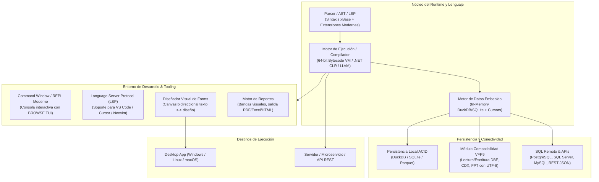
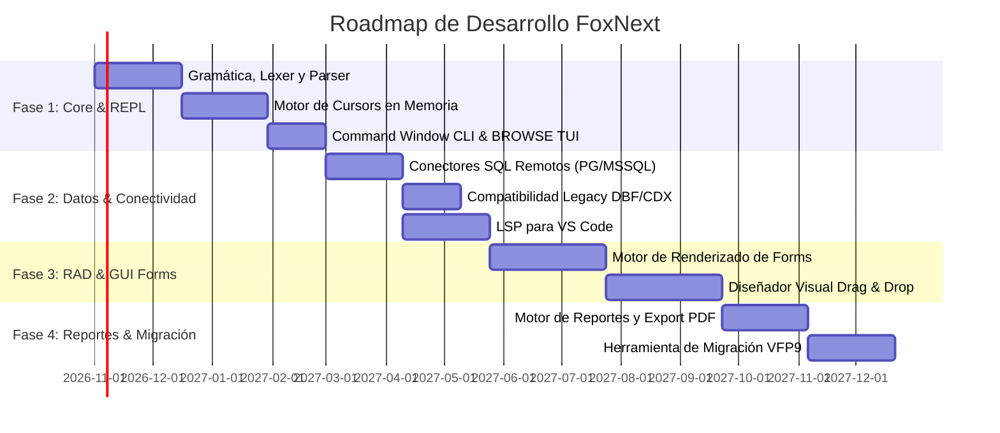

# FoxNext / VFP Moderno: Plan Maestro de Arquitectura y Desarrollo

## 1. Visión y Filosofía

**FoxNext** (VFP Moderno) es un entorno y lenguaje de desarrollo de aplicaciones centrado en datos (Data-Centric RAD), inspirado en la productividad, simplicidad y potencia de **Microsoft Visual FoxPro**, pero reinventado para la computación moderna de 64 bits, multiplataforma, preparada para la nube y compatible con Git.

### Qué rescatamos de Visual FoxPro clásico:
1. **Datos como ciudadanos de primera clase en la sintaxis:** El lenguaje no necesita capas pesadas de ORM para manipular datos. Las operaciones relacionales (`SELECT ... INTO CURSOR`, `SCAN...ENDSCAN`, `REPLACE`, `LOCATE`) son nativas.
2. **Cursores en memoria ultrarrápidos:** Tablas temporales indexables en memoria de alto rendimiento para procesamiento relacional local.
3. **Productividad RAD (Rapid Application Development):** Creación visual de formularios y reportes orientados a aplicaciones de gestión y líneas de negocio (LOB).
4. **Command Window / REPL Interactivo:** Posibilidad de inspeccionar, editar y explorar datos en tiempo real mediante comandos directos y visualización interactiva (`BROWSE`).
5. **Tipado dinámico con esteroides:** Facilidad de programación dinámica combinada con la opción de tipado gradual/estático moderno.

### Qué solucionamos de las limitaciones históricas de VFP:
1. **Adiós a los 32-bit y al límite de 2 GB:** Arquitectura 64-bit nativa, cursores y tablas capaces de manejar gigabytes/terabytes sin desbordamiento.
2. **Multiplataforma:** Compatibilidad con Windows, Linux y macOS tanto para desarrollo como para ejecución de aplicaciones y servicios.
3. **Formularios y código Git-Friendly:** Sustitución de los archivos binarios propietarios (`.scx`, `.vcx`, `.frx`) por definiciones declarativas en texto plano (YAML/JSON + código de eventos desacoplado).
4. **Soporte Unicode completo:** UTF-8 nativo en todo el runtime, motor de datos y UI.
5. **Red y persistencia segura:** Eliminación del riesgo de corrupción por bloqueos de red (SMB/Oplocks) mediante motores transaccionales ACID modernos.
6. **Integración con la Nube y APIs:** Soporte de primera clase para JSON, REST, WebSockets y microservicios.

---

## 2. Diagrama de Arquitectura Global



---

## 3. Especificación Técnica de Componentes

### 3.1. Núcleo del Lenguaje (The FoxNext Language)
- **Gramática:** Basada en xBase/FoxPro con mejoras modernas.
- **Tipado Gradual:** Soporte para tipado dinámico clásico (`LOCAL x = 10`) y tipado estático opcional (`LOCAL lnTotal AS Double = 10.50`).
- **Sintaxis SQL Nativa:** Comandos `SELECT`, `INSERT`, `UPDATE`, `DELETE` compilados como primitivas del lenguaje sin requerir `""` ni concatenación de cadenas:
  ```foxpro
  LOCAL ldFechaCorte = DATE() - 30

  SELECT c.id, c.nombre, SUM(f.importe) AS total_facturado ;
      FROM clientes c ;
      INNER JOIN facturas f ON c.id = f.cliente_id ;
      WHERE f.fecha >= ldFechaCorte ;
      GROUP BY c.id, c.nombre ;
      ORDER BY total_facturado DESC ;
      INTO CURSOR curResumen

  * Iteración nativa por registros
  SCAN FOR curResumen.total_facturado > 10000
      ? "Cliente Clave:", curResumen.nombre, "Total:", curResumen.total_facturado
  ENDSCAN
  ```
- **Manejo de Errores Moderno:** `TRY...CATCH...FINALLY` estructurado además del clásico `ON ERROR`.
- **Async/Await:** Capacidades asíncronas nativas para llamadas a bases de datos remotas y APIs HTTP sin bloquear la UI.

### 3.2. Motor de Datos Embebido y Cursors
- **Backend de Cursors:** Integración de un motor relacional en memoria optimizado (DuckDB o SQLite en memoria adaptado para cursores temporales).
- **Funcionalidades clásicas soportadas:**
  - `APPEND BLANK`, `REPLACE`, `DELETE`, `RECALL`, `PACK`.
  - `SEEK`, `LOCATE`, `INDEX ON ... TAG ...`.
  - `SET RELATION TO ... INTO ...`.
  - Buffering de registros y tablas con `TABLEUPDATE()` y `TABLEREVERT()`.
- **Interoperabilidad con Fuentes Externas:**
  - `SQLCONNECT()`, `SQLEXEC()`, `SQLDISCONNECT()`.
  - Conexión a PostgreSQL, Microsoft SQL Server, MySQL, SQLite y Oracle mediante drivers nativos optimizados.

### 3.3. Sistema de Formularios RAD (Git-Friendly)
- **Formato de Archivo:** En lugar de binarios `.scx`, cada formulario consta de:
  1. `nombre_form.foxform` (Definición jerárquica de componentes en YAML/JSON declarativo).
  2. `nombre_form.prg` (Lógica de eventos y métodos de la clase de formulario).
- **Diseñador Visual:** Editor interactivo tipo canvas que sincroniza instantáneamente el árbol de componentes con el archivo `.foxform`.
- **Enlace de Datos Bidireccional (Data-Binding):** Soporte de propiedad `ControlSource` vinculada directamente a campos del cursor o variables (`curClientes.nombre`).

### 3.4. Command Window & REPL Interactivo
- Consola interactiva para depuración y manipulación de datos en caliente.
- Comando `BROWSE`:
  - En terminal CLI: Vista tabular enriquecida en modo TUI (con navegación por teclado, edición de celdas y filtros).
  - En entorno GUI: Ventana DataGrid flotante con búsqueda rápida, ordenación por columnas y exportación instantánea a CSV/Excel.

### 3.5. Motor de Reportes
- Diseñador visual basado en bandas clásicas:
  - *Title / Summary*
  - *Page Header / Page Footer*
  - *Group Header / Group Footer*
  - *Detail Band*
- Formato de definición en texto plano (`.foxreport`).
- Exportación directa a PDF (con fuentes vectoriales e imágenes), Excel (.xlsx), HTML5 e impresión directa por controlador del sistema.

---

## 4. Comparativa de Opciones Tecnológicas para el Desarrollo

| Criterio | Opción A: Ecosistema .NET 8/9 + Avalonia UI | Opción B: Motor Nativo Rust + UI Moderna | Opción C: Go / Python con Runtime C |
| :--- | :--- | :--- | :--- |
| **Velocidad de Desarrollo** | **Muy Alta** (Ecosistema empresarial ya maduro) | Media (Mayor esfuerzo de infraestructura) | Alta |
| **Rendimiento de Datos** | Alto (Integrando DuckDB.NET / SQLite) | **Máximo** (Velocidad nativa C/Rust) | Alto |
| **Portabilidad GUI** | Excelente (Avalonia UI funciona en Win/Mac/Linux) | Buena (Tauri / Slint) | Media / Depende de bindings |
| **Interoperabilidad** | Inmediata con todo NuGet y librerías C# | Requiere bindings C FFI | CGO o extensiones C |
| **Recomendación** | **Estrategia Principal Recomendada** | **Alternativa para Core ultraliviano** | Ideal para prototipo inicial |

---

## 5. Roadmap de Implementación (Fase por Fase)



### Detalle de Fases:

#### **Fase 1: El Núcleo de Datos y el REPL (Meses 1–4)**
- [ ] Especificación formal de la gramática (EBNF / ANTLR / Tree-sitter).
- [ ] Implementación de AST y evaluador de expresiones de variables, operadores y funciones matemáticas/string estándar (`ALLTRIM`, `TRANSFORM`, `UPPER`, `SUBSTR`, `IIF`).
- [ ] Estructuras de control: `IF...ELSE...ENDIF`, `DO WHILE...ENDDO`, `FOR...ENDFOR`, `SCAN...ENDSCAN`.
- [ ] Implementación del motor de cursores in-memory con soporte para `CREATE CURSOR`, `APPEND BLANK`, `REPLACE`, `LOCATE`, `INDEX ON`.
- [ ] Soporte para `SELECT ... INTO CURSOR`.
- [ ] CLI REPL interactivo con comando `BROWSE` estilo consola.

#### **Fase 2: Conectividad y Tooling para Desarrolladores (Meses 5–7)**
- [ ] Módulo de conectividad SQL remota (`SQLCONNECT`, `SQLEXEC`) para PostgreSQL, SQL Server y SQLite.
- [ ] Lector/Escritor de tablas clásicas VFP 9 (`.dbf`, `.cdx`, `.fpt`) con soporte de conversión automática a UTF-8.
- [ ] Servidor de lenguaje (**LSP**) para VS Code con syntax highlighting, autocompletado inteligente de campos de cursores y diagnóstico de errores en tiempo real.

#### **Fase 3: Motor de Formularios RAD y Diseñador Visual (Meses 8–11)**
- [ ] Definición del formato declarativo `.foxform` (YAML/JSON).
- [ ] Controles de formulario estándar: `Form`, `TextBox`, `ComboBox`, `CheckBox`, `Button`, `Container`, `Grid` reactivo.
- [ ] Motor de data-binding (`ControlSource`) bidireccional automático.
- [ ] Diseñador visual con paleta de controles, inspector de propiedades y lienzo interactivo.

#### **Fase 4: Reportes y Herramientas de Migración (Meses 12–14)**
- [ ] Motor de reportes visuales con bandas (Header, Detail, Footer) y generador nativo de documentos PDF, Excel y HTML.
- [ ] Herramienta CLI de conversión `vfp2modern` que desensambla archivos binarios `.scx`, `.vcx`, `.frx` y `.pjx` de VFP 9 y genera los archivos legibles en texto plano.

---

## 6. Primer Paso de Acción Inmediata

1. Crear el prototipo del **Lexer/Parser** de expresiones y sentencias básicas.
2. Construir la abstracción de **Cursor en memoria** capaz de ejecutar:
   ```foxpro
   CREATE CURSOR personas (id I, nombre C(50), edad I)
   APPEND BLANK
   REPLACE id WITH 1, nombre WITH "Ada Lovelace", edad WITH 36
   SELECT * FROM personas WHERE edad > 30 INTO CURSOR mayores
   BROWSE
   ```
3. Configurar la suite de pruebas unitarias para validar equivalencia de resultados frente a FoxPro tradicional.
